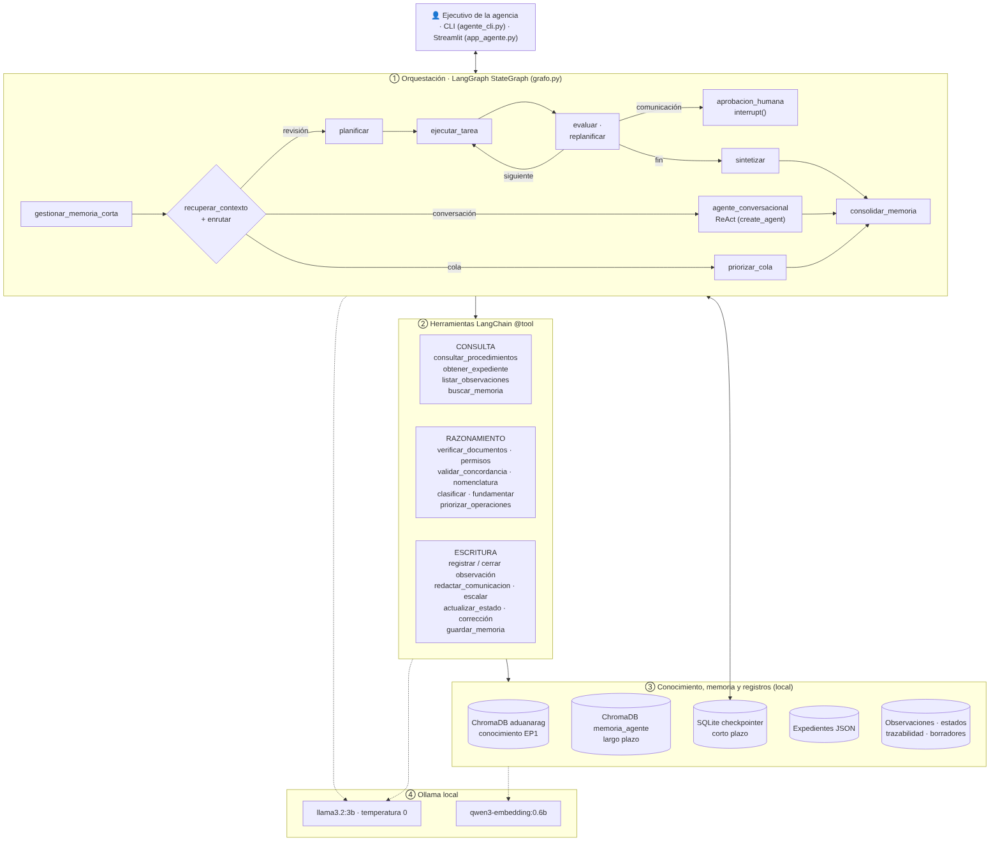
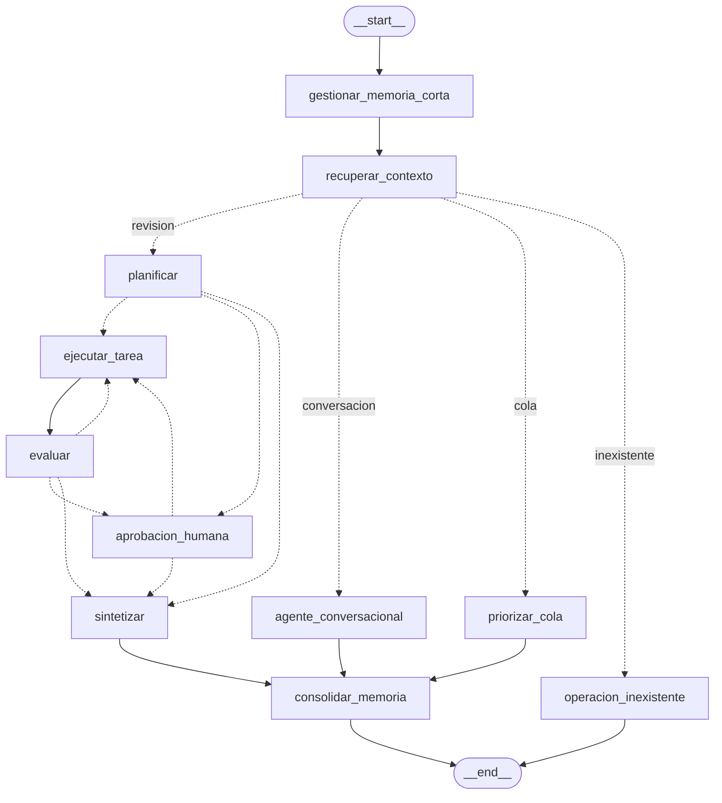
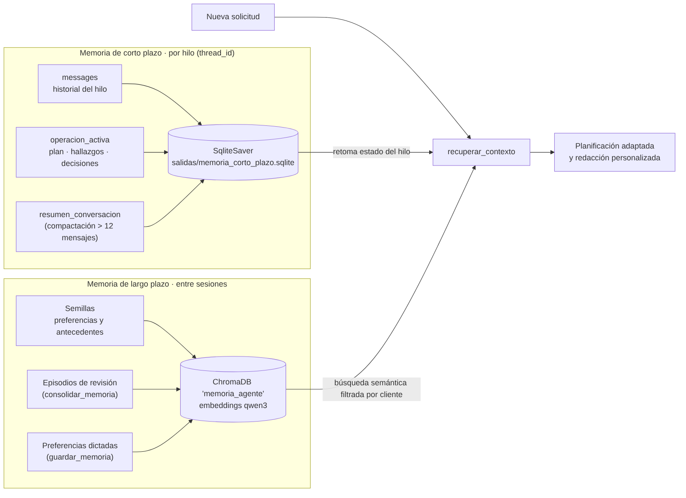
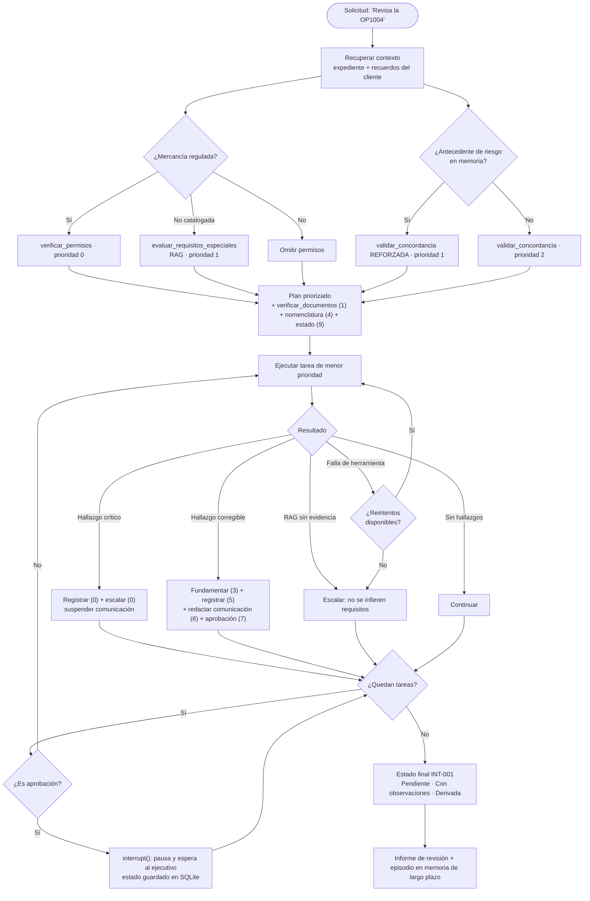
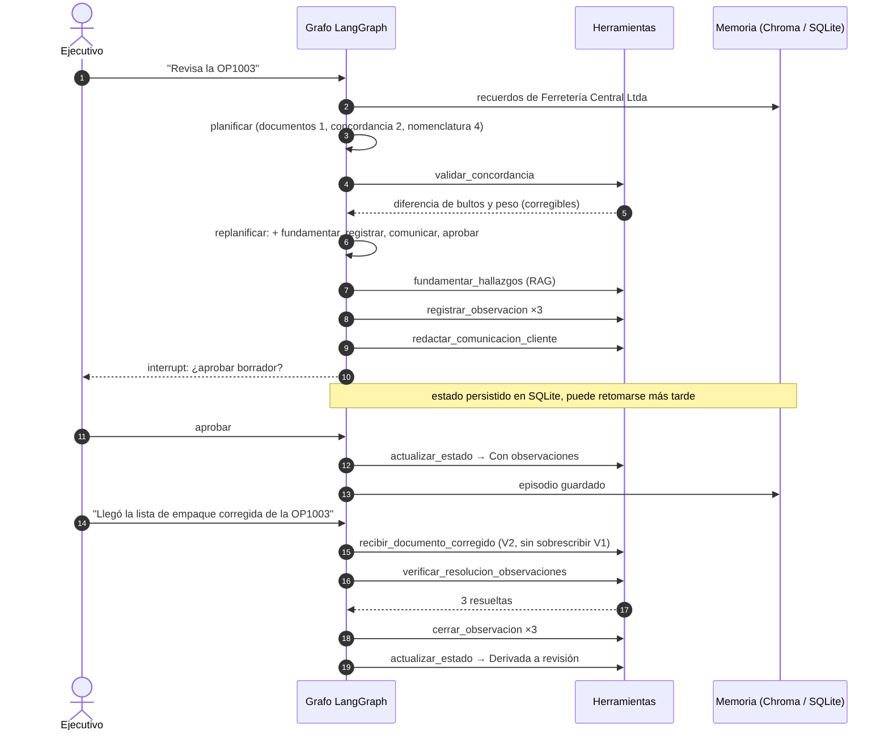

# AduanaAgent · Agente funcional de revisión documental aduanera

Proyecto de la asignatura **Ingeniería de Soluciones con Inteligencia Artificial (ISY0101) – Duoc UC**.

| Etapa | Entregable | Contenido |
|---|---|---|
| Evaluación Parcial 1 | **AduanaRAG** | Asistente RAG local para consultar procedimientos aduaneros (`src/consultar_rag.py`, `src/app.py`). |
| Evaluación Parcial 2 | **AduanaAgent** | Agente funcional sobre el RAG. Integra herramientas de consulta, razonamiento y escritura, memoria de corto y largo plazo, y planificación adaptativa (`src/agente/`). |
| Evaluación Parcial 3 | **Observabilidad** | Métricas de precisión, consistencia, errores, latencia y recursos; análisis de registros; dashboard; optimización de la latencia y protocolos de seguridad ([`documentacion/observabilidad.md`](documentacion/observabilidad.md)). |

> **Advertencia.** Proyecto exclusivamente académico. La organización (*Agencia de Aduanas del Norte*), los clientes, las operaciones y los documentos internos son **simulados**. El agente no autoriza operaciones, no presenta declaraciones y no reemplaza la revisión de un agente de aduana ni la normativa vigente.

---

## 1. Requerimiento organizacional

En una agencia de aduanas, cada operación de importación pasa por una **revisión documental** antes de preparar la destinación. El ejecutivo debe:

1. Comprobar que llegaron los antecedentes obligatorios (INT-001).
2. Verificar la concordancia entre la factura, el documento de transporte y la lista de empaque.
3. Detectar las mercancías sujetas a control previo y sus permisos (EXT-001).
4. Clasificar cada observación como informativa, corregible o crítica (INT-002).
5. Registrar, comunicar al cliente o escalar al responsable, dejando trazabilidad (INT-003).

Hoy este flujo es manual, depende de la experiencia del ejecutivo y se interrumpe cuando cambian las condiciones (por ejemplo, llega un documento corregido o el cliente tiene antecedentes). **AduanaAgent automatiza el flujo completo**, con supervisión humana obligatoria antes de cualquier comunicación externa.

## 2. Qué hace el agente

| Capacidad | Ejemplo de instrucción | Comportamiento |
|---|---|---|
| Revisión autónoma | `Revisa la OP1004` | Arma un plan priorizado, ejecuta las herramientas, replanifica según los hallazgos, registra, escala y fija el estado. |
| Condición cambiante | `Llegó la lista de empaque corregida de la OP1003, reprocésala` | Incorpora la V2 sin sobrescribir la V1, verifica las observaciones abiertas, las cierra y cambia el estado. |
| Priorización | `Prioriza la cola de revisión` | Ordena las operaciones por urgencia, cercanía del arribo y riesgo de la mercancía. |
| Consulta (ReAct) | `¿Qué debe hacer el ejecutivo si hay diferencias de peso?` | El LLM elige la herramienta y responde con fuente, o se abstiene si no hay evidencia. |
| Memoria | `Recuerda que Ferretería Central Ltda prefiere que escribamos a Jorge Díaz` | Guarda la preferencia y la usa en revisiones futuras, aunque sea otra sesión. |

## 3. Arquitectura y orquestación



El agente se construye con **LangGraph** (grafo de estados con checkpointer) y **LangChain** (herramientas `@tool`, prompts y agente ReAct `create_agent`). Usa por defecto los mismos modelos locales de la EP1 a través de **Ollama**; opcionalmente puede usar **Gemini Flash** cambiando una línea del `.env`.

### 3.1 Grafo implementado

El diagrama siguiente se **genera desde el grafo compilado** (`python src/exportar_diagrama.py`), por lo que refleja exactamente el código:



| Nodo | Responsabilidad |
|---|---|
| `gestionar_memoria_corta` | Compacta el hilo cuando supera 12 mensajes: resume los antiguos con el LLM y los elimina (`RemoveMessage`). |
| `recuperar_contexto` | Detecta la intención y la operación, carga el expediente y recupera recuerdos semánticos del cliente. |
| `planificar` | Crea el plan inicial priorizado según la mercancía, los antecedentes de memoria, las observaciones abiertas y las correcciones. |
| `ejecutar_tarea` | Ejecuta la tarea pendiente de menor prioridad invocando su herramienta. Reintenta ante fallas. |
| `evaluar` | Analiza el resultado y **replanifica**: agrega, eleva o suspende tareas, y registra cada decisión. |
| `aprobacion_humana` | `interrupt()` de LangGraph: pausa el flujo hasta que el ejecutivo aprueba o rechaza el borrador. |
| `sintetizar` | Genera el informe de revisión (`salidas/OPxxxx/informe_revision.md`) y un resumen con el LLM. |
| `agente_conversacional` | Agente ReAct (`create_agent`): el LLM decide qué herramienta usar para responder. |
| `priorizar_cola` | Secuencia la jornada de revisión. |
| `operacion_inexistente` | Responde sin usar el LLM cuando se pide revisar una operación que no existe. |
| `consolidar_memoria` | Guarda el episodio de la revisión en la memoria de largo plazo. |

### 3.2 Herramientas

| Tipo | Herramienta | Función |
|---|---|---|
| Consulta | `consultar_procedimientos` | RAG sobre la base de la EP1 con umbral de distancia y abstención controlada. |
| Consulta | `obtener_expediente`, `listar_observaciones`, `buscar_memoria` | Expediente y estado, registro de observaciones y recuerdos de largo plazo. |
| Razonamiento | `verificar_documentos_requeridos` | Documentos obligatorios (INT-001), certificado de origen si hay preferencia, legibilidad y datos mínimos. |
| Razonamiento | `verificar_permisos` | Control previo por categoría de mercancía y organismo competente (EXT-001). |
| Razonamiento | `validar_concordancia` | Bultos, peso, descripción, valor e importador. En modo *reforzado* también valida el RUT del cliente y la referencia de la operación. |
| Razonamiento | `validar_nomenclatura`, `clasificar_observacion` | Convención de nombres (INT-003) y nivel de la observación (INT-002). |
| Razonamiento | `evaluar_requisitos_especiales`, `fundamentar_hallazgos` | Consultan el RAG para mercancías no catalogadas y para respaldar cada hallazgo con su fuente. |
| Razonamiento | `verificar_resolucion_observaciones`, `priorizar_operaciones` | Cierre de observaciones resueltas y orden de la cola. |
| Escritura | `registrar_observacion`, `cerrar_observacion` | Registro con los campos de INT-002, sin duplicados. |
| Escritura | `redactar_comunicacion_cliente` | Borrador con documento afectado, inconsistencia y acción necesaria. |
| Escritura | `actualizar_estado_operacion`, `escalar_a_responsable` | Estados de INT-001 y ticket de escalamiento. |
| Escritura | `recibir_documento_corregido`, `guardar_memoria` | Versionado sin sobrescritura y nuevas preferencias. |

Toda escritura deja un registro en `salidas/trazabilidad.jsonl` con los campos de INT-003: usuario, fecha y hora, operación, acción, documento, resultado y observaciones.

## 4. Memoria y recuperación de contexto



| Tipo | Implementación | Para qué sirve |
|---|---|---|
| **Corto plazo** | Estado del grafo (`messages`, `operacion_activa`, `plan`, `hallazgos`, `decisiones`) persistido con **`SqliteSaver`** por `thread_id`. | Permite continuar el diálogo (por ejemplo, *"¿qué observaciones quedaron?"* se refiere a la última operación revisada) y **retomar un flujo pausado** incluso después de cerrar el programa. |
| **Compactación** | Sobre 12 mensajes se resumen los antiguos con el LLM y se eliminan del estado. | Respeta la ventana de contexto de un modelo de 3B sin perder lo decidido. |
| **Largo plazo** | Colección ChromaDB `memoria_agente` (en `salidas/memoria_largo_plazo/`), con embeddings `qwen3-embedding:0.6b` y metadatos (`tipo`, `cliente`, `clave`, `valor`). | Guarda preferencias, antecedentes y episodios entre sesiones. |
| **Recuperación semántica** | `similarity_search_with_score` filtrado por cliente y con umbral de distancia. | Recupera solo los recuerdos pertinentes, que modifican el plan (validación reforzada) y la redacción (destinatario y plazo). |

## 5. Planificación y toma de decisiones

El plan es una lista de tareas con prioridad (0 = primero). Siempre se ejecuta la tarea pendiente de menor `(prioridad, secuencia)`.

| Prioridad | Tareas |
|---:|---|
| 0 | Incorporar corrección · verificar permisos (mercancía regulada) · registrar y escalar críticas (dinámico) |
| 1 | Verificar resolución de observaciones previas · documentos requeridos · requisitos de mercancía no catalogada · concordancia **reforzada** por antecedente |
| 2 | Concordancia normal |
| 3 | Fundamentar hallazgos (RAG) |
| 4 | Nomenclatura |
| 5–7 | Registrar · redactar comunicación · aprobación humana |
| 9 | Actualizar estado (siempre al final) |

**Reglas de replanificación** (`src/agente/planificador.py`):

- Hallazgo **crítico**: registrar y escalar con prioridad 0 y suspender la comunicación al cliente.
- Hallazgo **corregible**: fundamentar, registrar, redactar la comunicación y exigir aprobación humana.
- **RAG sin evidencia** o hallazgo sin respaldo: escalar en lugar de suponer.
- **Falla de herramienta** (por ejemplo, Ollama caído): reintentar una vez; si persiste, marcar como fallida y escalar.
- **Observaciones abiertas** y una corrección recibida: verificar la resolución y cerrar las observaciones.
- **Antecedente de riesgo en memoria**: validación reforzada y adelantada.
- **Preferencia del cliente en memoria**: cambia el destinatario y el plazo del borrador.



### 5.1 Ejemplo de flujo de trabajo (OP1003)



### 5.2 Escenarios que demuestran la adaptación

`python src/demo_escenarios.py` ejecuta 10 escenarios y deja la evidencia en `evidencias/agente/<modo>/`.

| # | Escenario | Condición | Comportamiento esperado |
|---:|---|---|---|
| 1 | OP1001 | Expediente correcto | Derivada a revisión sin observaciones |
| 2 | OP1002 | Faltan la lista de empaque y el certificado de origen; cliente con preferencia | Pendiente de documentación; borrador a Paula Rojas con plazo de 48 h; aprobación humana |
| 3 | OP1003 | Diferencia de bultos y peso | Con observaciones; comunicación aprobada |
| 4 | OP1004 | Alimentos sin permiso SAG/sanitario, RUT distinto, antecedente del cliente | Permisos primero; validación reforzada; escalamiento; **sin** comunicación |
| 5 | OP1004 sin memoria | Mismo expediente, sin antecedentes | Plan distinto: validación normal con prioridad 2 |
| 6 | OP1005 | Mercancía no catalogada + factura ilegible | Consulta el RAG; confirma o escala según la evidencia |
| 7 | OP1003 V2 | Llega la lista de empaque corregida | Nueva versión, cierre de 3 observaciones, Derivada a revisión |
| 8 | Continuidad | Flujo pausado; el programa se reinicia | El nuevo proceso retoma en `aprobacion_humana` |
| 9 | Cola | Varias operaciones pendientes | Orden con puntaje y justificación |
| 10 | Conversación | Preguntas y una preferencia nueva | El LLM elige la herramienta; la preferencia se recupera desde otro hilo |

## 6. Instalación (Windows)

Requisitos: Windows 10/11, Python 3.10 o superior (probado con 3.12), Git y **uno** de estos proveedores de modelos:

- **Ollama** (por defecto, local y gratuito): [ollama.com](https://ollama.com), al menos 8 GB de RAM.
- **Gemini** (opcional, API gratuita): clave en [aistudio.google.com/apikey](https://aistudio.google.com/apikey).

```cmd
git clone https://github.com/maca2003/repo-INGENIERIA-DE-SOLUCIONES-CON-INTELIGENCIA-ARTIFICIAL.git
cd repo-INGENIERIA-DE-SOLUCIONES-CON-INTELIGENCIA-ARTIFICIAL
py -3.12 -m venv .venv
.venv\Scripts\activate
python -m pip install --upgrade pip
python -m pip install -r requirements.txt
copy .env.example .env
```

**Opción A · Ollama** (deja `AGENTE_PROVEEDOR=ollama` en `.env`):

```cmd
ollama pull llama3.2:3b
ollama pull qwen3-embedding:0.6b
```

**Opción B · Gemini**: en `.env`, cambiar a `AGENTE_PROVEEDOR=gemini` y pegar la clave en `GOOGLE_API_KEY`.

Luego, con cualquiera de las dos opciones:

```cmd
python src\probar_modelos.py          :: debe imprimir CONEXION LLM CORRECTA
python src\crear_base_vectorial.py    :: base de conocimiento (una sola vez)
```

La base queda en `chroma_db/` (Ollama) o `chroma_db_gemini/` (Gemini), porque los vectores de modelos distintos no son comparables. Para calibrar el umbral del RAG con las distancias reales del modelo elegido: `python src\calibrar_umbral.py`.

> **PowerShell:** si aparece "la ejecución de scripts está deshabilitada", usar CMD o ejecutar `Set-ExecutionPolicy -Scope CurrentUser RemoteSigned`.

## 7. Ejecución

| Acción | Comando |
|---|---|
| Interfaz web del agente | `streamlit run src\app_agente.py` |
| Agente en terminal | `python src\agente_cli.py --hilo turno_manana` |
| **Toda la evidencia en un paso** | `python src\generar_evidencias.py --capturas` |
| Escenarios de demostración | `python src\demo_escenarios.py` |
| Pruebas automatizadas | `python -m pytest -v` |
| Pruebas con el modelo real | `python -m pytest -m real -v` |
| Exportar el diagrama del grafo | `python src\exportar_diagrama.py` |
| RAG de la EP1 | `streamlit run src\app.py` o `python src\consultar_rag.py` |
| **EP3:** benchmark de observabilidad (base vs optimizado) | `python src\evaluar_observabilidad.py` |
| **EP3:** análisis de registros | `python src\analizar_logs.py` |
| **EP3:** dashboard de observabilidad | `streamlit run src\dashboard_observabilidad.py` |
| **EP3:** toda la evidencia de observabilidad | `python src\generar_evidencias.py --solo-observabilidad --capturas` |

Todos los scripts aceptan `--simulado` (por ejemplo, `python src\agente_cli.py --simulado`), que ejecuta el agente **sin LLM** con un modelo y embeddings deterministas. Este modo se usa en las pruebas y en GitHub Actions. Las evidencias válidas del comportamiento con LLM son las de `evidencias/agente/ollama/` o `evidencias/agente/gemini/`.

Comandos dentro del CLI: `/plan`, `/decisiones`, `/memoria`, `/hilo NOMBRE`, `/salir`. Si un hilo quedó pausado esperando aprobación, al volver a abrirlo con el mismo `--hilo` el agente retoma el flujo.

### Ejemplos de uso

| Escribir en la interfaz | Qué hace el agente |
|---|---|
| `Revisa la OP1003` | Detecta diferencias de bultos y peso, registra 3 observaciones, redacta el borrador y pide aprobación |
| `¿Qué observaciones quedaron?` | Responde sobre la OP1003 sin que se la nombren (memoria corta) |
| `Llegó la lista de empaque corregida de la OP1003, reprocésala` | Versiona el documento, cierra las observaciones y deriva a revisión |
| `Revisa la OP1004` | Verifica permisos primero, recuerda el antecedente del cliente y escala sin escribirle |
| `Prioriza la cola de revisión` | Ordena las operaciones pendientes por urgencia, arribo y riesgo |
| `Revisa la OP9999` | Informa que la operación no existe y lista las disponibles |

## 8. Pruebas y evidencias

`python src\generar_evidencias.py --capturas` ejecuta todo y deja un resumen en `evidencias/RESUMEN_EVIDENCIAS_<proveedor>.md`. Las capturas automáticas requieren, una sola vez, `pip install -r requirements-evidencias.txt` y `python -m playwright install chromium`.

| Archivo | Qué prueba |
|---|---|
| `tests/test_herramientas.py` | Cada herramienta cumple su función (IE1) |
| `tests/test_memoria.py` | Memoria corta, compactación, persistencia y reanudación; memoria larga y recuperación semántica (IE3, IE4) |
| `tests/test_planificacion.py` | Prioridades, replanificación, fallas, correcciones y rechazo humano (IE5, IE7) |
| `tests/test_e2e.py` | Flujos completos de punta a punta, incluida una operación inexistente |
| `tests/test_integracion_real.py` | Las mismas capacidades con el modelo real del `.env` (se omiten si no está disponible) |
| `tests/test_observabilidad.py` | Registro de eventos, enmascaramiento, guardarraíl, retención, métricas y reducción de llamadas al LLM (EP3) |

- `evidencias/pytest_output.txt`: salida completa de `pytest -v`.
- `evidencias/agente/<proveedor>/`: informe por escenario, registro de observaciones, trazabilidad, estados y memoria exportada.
- `evidencias/capturas/<proveedor>/`: capturas de la interfaz en las 4 escenas de la demo.
- `.github/workflows/pruebas.yml`: ejecuta las pruebas y los escenarios en cada *push*.
- `evidencias/observabilidad/<proveedor>/`: métricas (`metricas.json`, `resumen.md`), casos (`casos.csv`), registros (`eventos.jsonl`) y hallazgos (`hallazgos_logs.md`) de la EP3.
- `evidencias/capturas/dashboard/<proveedor>/`: capturas de cada pestaña del dashboard.
- `evidencias/` (raíz): evidencias de la EP1 (evaluación RAG: 10/10).

### 8.1 Documentación por fases

| Documento | Contenido |
|---|---|
| [`documentacion/guia_fases.md`](documentacion/guia_fases.md) | Cómo se cumple cada fase de la guía EVA02, diferencias justificadas, mapa de indicadores y checklist |
| [`documentacion/alcance.md`](documentacion/alcance.md) | Qué hace y qué no hace el agente, y métricas de éxito |
| [`documentacion/herramientas.md`](documentacion/herramientas.md) | Contrato de entrada y salida de las 20 herramientas |
| [`documentacion/reglas.md`](documentacion/reglas.md) | Prioridades, reglas de replanificación y reglas de estado |
| [`documentacion/diagrama_orquestacion.md`](documentacion/diagrama_orquestacion.md) | Diagramas Mermaid de orquestación y flujo |
| [`documentacion/guion_demo.md`](documentacion/guion_demo.md) | Guion de 10 minutos en 4 escenas, roles y plan B |
| [`documentacion/observabilidad.md`](documentacion/observabilidad.md) | EP3: arquitectura de observabilidad, métricas, optimización, boceto del dashboard y protocolos de seguridad |

## 9. Estructura del proyecto

```text
├── data/
│   ├── internos/ externos/        # Base de conocimiento (EP1)
│   ├── operaciones/               # Expedientes simulados OP1001–OP1005 (+ correcciones/)
│   └── memoria_inicial/           # Semillas de memoria de largo plazo
├── documentacion/                 # Alcance, herramientas, reglas, guion, guía por fases
│   └── diagramas/                 # Diagramas Mermaid (.mmd) y PNG
├── evidencias/                    # pytest_output, agente/, capturas/, observabilidad/<proveedor>/
├── src/
│   ├── agente/
│   │   ├── config.py              # Parámetros (.env)
│   │   ├── reglas.py              # Reglas INT-001/002/003 y EXT-001
│   │   ├── herramientas/          # consulta.py · razonamiento.py · escritura.py
│   │   ├── memoria.py             # Checkpointer SQLite y memoria Chroma
│   │   ├── planificador.py        # Plan priorizado y replanificación
│   │   ├── grafo.py               # Orquestación LangGraph
│   │   ├── modelos.py             # Proveedor de modelos: Ollama o Gemini
│   │   ├── servicios.py           # Inyección real / simulado
│   │   ├── simulacion.py          # Componentes deterministas para pruebas
│   │   ├── almacen.py             # Expedientes, registros y trazabilidad
│   │   ├── observabilidad.py      # (EP3) Registro de eventos, trazas y recursos
│   │   ├── seguridad.py           # (EP3) Enmascaramiento de datos y guardarraíl
│   │   └── analitica.py           # (EP3) Métricas y análisis de registros
│   ├── agente_cli.py · app_agente.py · demo_escenarios.py · generar_evidencias.py
│   ├── (EP3) evaluar_observabilidad.py · analizar_logs.py · dashboard_observabilidad.py
│   ├── calibrar_umbral.py · exportar_diagrama.py
│   └── (EP1) cargar_documentos.py · fragmentar_documentos.py · crear_base_vectorial.py
│              consultar_rag.py · evaluar_rag.py · app.py · probar_modelos.py
├── tests/
├── .env.example · pytest.ini · requirements.txt · requirements-evidencias.txt
```

`chroma_db/`, `chroma_db_gemini/`, `salidas/`, `.venv/` y `.env` se generan localmente y no se publican.

## 10. Decisiones de diseño

| Decisión | Alternativas evaluadas | Justificación |
|---|---|---|
| **LangGraph** como orquestador | AgentExecutor de LangChain, AutoGen, Haystack Agents | Grafo explícito y auditable; checkpointer nativo para la memoria corta; `interrupt()` para la supervisión humana. Continúa el stack LangChain de la EP1. |
| Planificador **híbrido** (reglas + LLM) | Plan generado íntegramente por el LLM | Un modelo de 3B no genera planes JSON confiables. Las reglas trazables a INT-001/002/003 hacen las decisiones auditables. El LLM se usa donde aporta: RAG, elección de herramientas en la conversación y síntesis. |
| **ReAct** solo para la conversación, con 6 herramientas | Exponer las 20 herramientas | Menos herramientas mejora la precisión de la elección en modelos pequeños, y las de escritura quedan bajo el flujo controlado. |
| Memoria larga en **ChromaDB** | LangGraph Store, archivo JSON | Reutiliza el motor y los embeddings de la EP1, permite búsqueda semántica con filtros por cliente y persiste localmente. |
| Memoria corta en **SQLite** | `InMemorySaver` | Sobrevive al cierre del programa: un flujo pausado se retoma después. |
| **Ollama** local, temperatura 0 (Gemini opcional) | Solo API en la nube | Confidencialidad de los documentos (INT-003), costo cero y respuestas deterministas. Gemini queda como alternativa configurable para equipos que no pueden ejecutar Ollama. |
| LangChain 1.x + LangGraph 1.x, versiones acotadas | `langchain<1.0` con `AgentExecutor` | `AgentExecutor` y `ConversationBufferMemory` están obsoletos; LangGraph aporta el checkpointer y el `interrupt`. |
| Humano en el ciclo | Envío automático | Las comunicaciones externas y las críticas requieren a una persona responsable (INT-002, EXT-002). |
| Modo simulado inyectable | Pruebas solo con Ollama | Pruebas reproducibles en CI sin GPU; la lógica del agente es la misma. |

## 11. Seguridad y limitaciones

- No inventa información. Ante falta de evidencia se abstiene o escala.
- No autoriza operaciones ni envía comunicaciones sin aprobación humana.
- Opera con expedientes simulados en JSON. Una versión real requiere OCR o extracción desde PDF, control de acceso y respaldo.
- La calidad de la elección de herramientas depende del modelo local. Con 3B puede fallar en preguntas ambiguas, por eso el flujo crítico es determinista.
- El umbral de distancia debe recalibrarse si cambian los documentos o el modelo de embeddings.
- Los registros de observabilidad enmascaran datos personales y se eliminan a los 30 días; las entradas peligrosas se bloquean antes de llegar al modelo (ver `documentacion/observabilidad.md`).

## 12. Declaración de uso de inteligencia artificial

| Herramienta | Uso | Validado por |
|---|---|---|
| Ollama llama3.2:3b / Gemini Flash | Motor del agente (RAG, elección de herramientas, síntesis) | Equipo completo |
| Claude (Anthropic) | Apoyo en la estructura del código, documentación, diagramas y datos simulados | [Completar: integrante que revisó cada parte] |

Las conclusiones, las reflexiones individuales y las justificaciones técnicas del informe fueron redactadas por el equipo sin asistencia de IA. [Ajustar si corresponde.]

## 13. Referencias

Google. (s. f.). *Gemini API models*. Google AI for Developers. https://ai.google.dev/gemini-api/docs/models

Chase, H. (2022). *LangChain* [Software]. GitHub. https://github.com/langchain-ai/langchain

Chroma. (s. f.). *Query and get*. https://docs.trychroma.com/docs/querying-collections/query-and-get

LangChain. (s. f.-a). *Agents*. LangChain Docs. https://docs.langchain.com/oss/python/langchain/agents

LangChain. (s. f.-b). *Interrupts*. LangGraph Docs. https://docs.langchain.com/oss/python/langgraph/interrupts

LangChain. (s. f.-c). *Memory overview*. LangGraph Docs. https://docs.langchain.com/oss/python/langgraph/memory

LangChain. (s. f.-d). *Persistence*. LangGraph Docs. https://docs.langchain.com/oss/python/langgraph/persistence

Ollama. (s. f.). *Embeddings*. https://docs.ollama.com/capabilities/embeddings

Packer, C., Wooders, S., Lin, K., Fang, V., Patil, S. G., Stoica, I., & Gonzalez, J. E. (2023). *MemGPT: Towards LLMs as operating systems*. arXiv. https://doi.org/10.48550/arXiv.2310.08560

Servicio Nacional de Aduanas. (s. f.). *Portal institucional*. https://www.aduana.cl/

Wang, L., Xu, W., Lan, Y., Hu, Z., Lan, Y., Lee, R. K.-W., & Lim, E.-P. (2023). Plan-and-solve prompting: Improving zero-shot chain-of-thought reasoning by large language models. En *Proceedings of the 61st Annual Meeting of the Association for Computational Linguistics* (pp. 2609–2634). https://doi.org/10.18653/v1/2023.acl-long.147

Yao, S., Zhao, J., Yu, D., Du, N., Shafran, I., Narasimhan, K., & Cao, Y. (2023). ReAct: Synergizing reasoning and acting in language models. En *International Conference on Learning Representations (ICLR 2023)*. https://arxiv.org/abs/2210.03629

## 14. Equipo

- Roberto González
- Macarena Muñoz

Docente: Cristian Rodrigo Araya Salazar · Duoc UC · 2026
