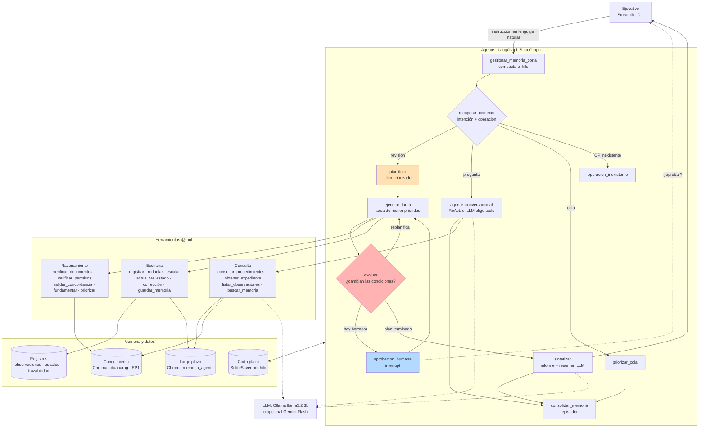
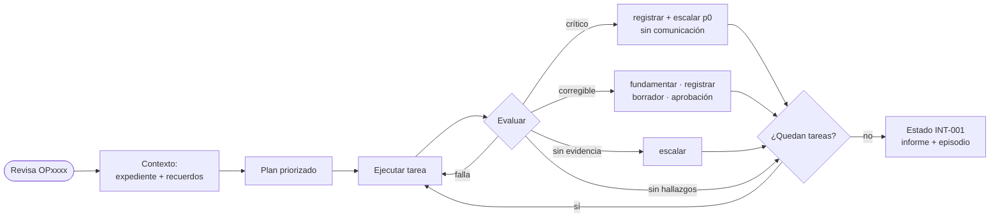

# Diagrama de orquestación del agente

Fase 10.2 de la guía. GitHub dibuja estos diagramas Mermaid automáticamente. Las versiones en imagen están en `documentacion/diagramas/`.

## 1. Orquestación de componentes

## 2. Grafo real exportado desde el código

`python src/exportar_diagrama.py` genera `documentacion/diagramas/grafo_langgraph.mmd` directamente desde el grafo compilado. Este diagrama es exactamente lo que se ejecuta.

## 3. Flujo de una revisión con replanificación

## 4. Secuencia del caso OP1003 (incluye condición cambiante)

Ver `documentacion/diagramas/secuencia_op1003.mmd` o la imagen `secuencia_op1003.png`.
