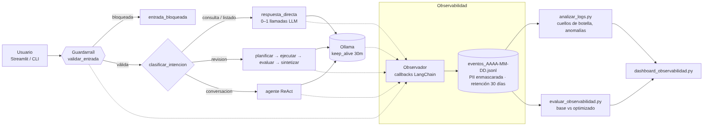
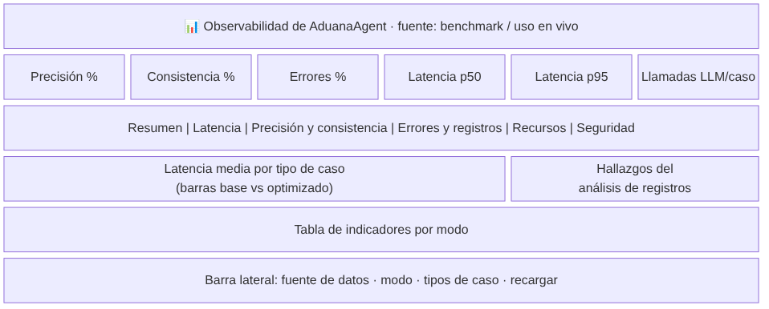

# Observabilidad de AduanaAgent (EP3)

## 1. Arquitectura



| Componente | Archivo | Función |
|---|---|---|
| Observador | `src/agente/observabilidad.py` | *Callback* de LangChain que registra cada solicitud, nodo del grafo, herramienta y llamada al LLM, con su duración, tokens, carga del modelo, memoria y CPU del proceso. |
| Seguridad | `src/agente/seguridad.py` | Enmascara datos personales antes de escribir cualquier registro y bloquea entradas peligrosas antes de llegar al modelo. |
| Métricas | `src/agente/analitica.py` | Calcula precisión, consistencia, errores, latencia y recursos; detecta cuellos de botella y anomalías. |
| Benchmark | `src/evaluar_observabilidad.py` | Ejecuta 30 casos × 3 repeticiones en modo **base** (EP2) y **optimizado**, con datos variados. |
| Análisis de registros | `src/analizar_logs.py` | Genera `hallazgos_logs.md` con fallas y cuellos de botella. |
| Dashboard | `src/dashboard_observabilidad.py` | Visualización en Streamlit del benchmark y del uso en vivo. |

Cada evento es una línea JSON en `salidas/observabilidad/eventos_AAAA-MM-DD.jsonl` (uso diario) o en `evidencias/observabilidad/<proveedor>/eventos.jsonl` (benchmark). Todos los eventos de una solicitud comparten el mismo identificador de `traza`.

| Tipo de evento | Campos principales |
|---|---|
| `solicitud` | duración, intención, operación, llamadas al LLM, tokens, tiempo LLM y herramientas, errores, memoria (MB), CPU (ms) |
| `nodo` | nodo del grafo y duración |
| `herramienta` | herramienta, duración, estado, resumen del resultado (p. ej. si el RAG se abstuvo) |
| `llm` | modelo, nodo, tokens de entrada/salida, carga del modelo (arranque en frío), tokens/s |
| `recuperacion` | duración de la búsqueda en ChromaDB y mejor distancia |
| `seguridad` | motivo del bloqueo |
| `precalentamiento` | segundos para cargar los modelos al iniciar |

## 2. Métricas

| Métrica | Definición | Indicador |
|---|---|---|
| Precisión | % de casos correctos. Revisión: estado final, tipos de hallazgo y escalamiento esperados. Consulta: contiene todos los conceptos clave o se abstiene cuando no hay evidencia. Seguridad: entrada bloqueada. | IE1 |
| Consistencia | % de casos con el mismo resultado en las 3 repeticiones; se complementa con la similitud textual (Jaccard) entre respuestas. | IE1 |
| Frecuencia de errores | % de casos con excepción o evento de error. | IE1 |
| Variabilidad de datos | 8 variantes generadas de OP1001/OP1002 (OP2001–OP2008) y paráfrasis de las consultas. | IE1 |
| Latencia | Media, p50, p95 y máximo por tipo de caso; latencia de la primera consulta (arranque en frío). | IE2 |
| Uso de recursos | Llamadas al LLM, tokens, tokens/s, memoria del proceso, CPU y memoria de los modelos en Ollama. | IE2 |

## 3. Optimización de la latencia

El análisis de registros de la EP2 mostró que el LLM concentra casi todo el tiempo de respuesta. Las medidas aplicadas (activas con `AGENTE_OPTIMIZADO=true`; con `false` se recupera el comportamiento de la EP2 para comparar):

| Causa detectada | Medida |
|---|---|
| Una consulta de procedimiento pasaba por ReAct: hasta 3 llamadas al LLM (elegir herramienta, responder con RAG, reformular). | Ruta directa: las preguntas de procedimiento van a `consultar_procedimientos` con 1 llamada; los listados de observaciones no llaman al LLM. |
| Ollama descarga el modelo tras 5 minutos sin uso; la siguiente consulta paga la carga. | `keep_alive=30m` y precalentamiento de los modelos al iniciar. |
| El resumen final de una revisión se redactaba con el LLM. | Resumen estructurado con plantilla a partir de los hallazgos ya calculados. |
| Respuestas largas y contexto amplio. | `num_predict=320` y `num_ctx=4096`. |
| Búsqueda en memoria de largo plazo en todas las consultas. | Se omite en consultas de procedimiento y listados. |

## 4. Boceto del dashboard



Pestañas: **Resumen** (indicadores, hallazgos, comparación), **Latencia** (distribución, por caso, reparto del tiempo, LLM por nodo, arranques en frío), **Precisión y consistencia** (por tipo, mapa de resultados, casos incorrectos), **Errores y registros** (errores, anomalías, explorador con filtros), **Recursos** (memoria, CPU, tokens/s) y **Seguridad** (bloqueos y protocolos).

## 5. Seguridad, privacidad y uso responsable

| Protocolo | Implementación |
|---|---|
| Minimización y enmascaramiento | RUT, correos, teléfonos y números de tarjeta se reemplazan por `[RUT]`, `[CORREO]`, `[TELEFONO]` y `[TARJETA]` antes de escribir un registro. Las entradas se truncan. |
| Retención limitada | Un archivo por día; los de más de `AGENTE_RETENCION_LOGS_DIAS` (30) se eliminan automáticamente. |
| Guardarraíl de entrada | Bloquea entradas vacías o de más de 1000 caracteres, intentos de inyección de instrucciones, código y solicitudes de autorizar operaciones o borrar registros. Lo bloqueado no llega al modelo y queda registrado. |
| Procesamiento local | Con Ollama, los expedientes y los registros no salen del equipo. Los registros están excluidos de Git (`salidas/`). |
| Supervisión humana | Las comunicaciones al cliente requieren aprobación; las observaciones críticas se escalan a una persona. |
| Marco normativo | Ley N.° 19.628 sobre protección de la vida privada y Ley N.° 21.719, que la reforma y entra en vigor el 1 de diciembre de 2026 (principios de finalidad, proporcionalidad, seguridad y responsabilidad). |

## 6. Ejecución

```bat
python src\evaluar_observabilidad.py          :: benchmark base vs optimizado (modelo del .env)
python src\analizar_logs.py                   :: hallazgos en los registros
streamlit run src\dashboard_observabilidad.py :: dashboard
python src\generar_evidencias.py --solo-observabilidad --capturas   :: todo lo anterior + capturas
```

Variables del `.env`: `AGENTE_OPTIMIZADO`, `AGENTE_KEEP_ALIVE`, `AGENTE_NUM_PREDICT`, `AGENTE_NUM_CTX`, `AGENTE_OBSERVABILIDAD`, `AGENTE_RETENCION_LOGS_DIAS`, `AGENTE_MAX_LARGO_ENTRADA`.
